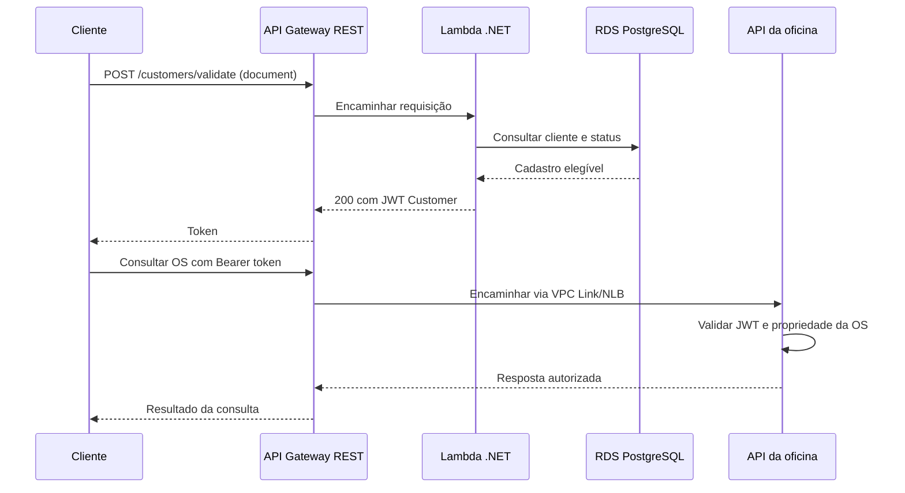

# Autenticação de Clientes do Sistema de Gerenciamento de Mecânica

Repositório da função AWS Lambda que valida o documento (CPF ou CNPJ numérico) de um cliente e emite um JWT para acesso às suas ordens de serviço. O login com senha dos usuários internos permanece na API da oficina.

## Provisionamento com SAM — 2026-10-11

A autenticação usa SAM/CloudFormation com ZIP, conforme [ADR 009](https://github.com/pknfelps/GerenciamentoMecanicaSistema/blob/develop/docs/arquitetura/adrs/009-SAM-AUTENTICACAO.md). [template.yaml](template.yaml) declara os recursos e [samconfig.toml](samconfig.toml) configura as stacks hom/prd. Bootstrap/base/banco/Gateway continuam Terraform; role/policies auth-runtime persistem no bootstrap.

CI/testes .NET/PostgreSQL, pacote Auth.Contracts 1.0.0, HTTP/JWT e conexão segura não mudam. O código Terraform auth foi retirado depois da conferência AWS: nenhuma função/stack/log group/parâmetro auth ou estado atual/histórico em hom/prd. O novo bootstrap precisa de aplicação aprovada; role CI, quota e recriação base/banco/Job continuam pendentes.

## Estado da implementação

Solução .NET 10 organizada em Domain, Application, Infrastructure e Function, com ApplicationTests, ContractTests, InfrastructureTests e FunctionTests. Handler, consulta de elegibilidade e emissão JWT estão implementados e testados localmente. A função ainda não está implantada ou exposta pelo Gateway.

Infraestrutura SAM e quatro workflows estão preparados. A validação local aprovou 217 testes sem ignorados e build/empacotamento SAM, incluindo certificado RDS. E3.1/E3.2/E3.6/E3.9 e E2.12 permanecem abertas até suas validações reais.
## Estrutura da solução

A [solução](GerenciamentoMecanicaAutenticacao.slnx) reúne os quatro projetos de produção, ApplicationTests para domínio/caso de uso, ContractTests independente e InfrastructureTests para configuração, adaptadores e integração PostgreSQL, e FunctionTests para o contrato HTTP/serialização Lambda. As dependências das camadas de produção seguem esta organização:

| Projeto | Responsabilidade | Referências de projetos |
|---|---|---|
| [Domain](Domain/Domain.csproj) | Modelos e regras do domínio da autenticação | Nenhuma |
| [Application](Application/Application.csproj) | Casos de uso e interfaces de consulta/emissão | Domain |
| [Infrastructure](Infrastructure/Infrastructure.csproj) | Configuração AWS, banco e adaptação do pacote compartilhado | Domain e Application |
| [Function](Function/Function.csproj) | Entrada Lambda e composição das dependências | Application e Infrastructure |

Todos são bibliotecas net10.0, com nullable e implicit usings habilitados. Assemblies e namespaces usam o prefixo GerenciamentoMecanica.Autenticacao seguido do nome da camada. Domain e Application não dependem de AWS, banco ou tipos Lambda. Infrastructure é a camada de produção que referencia Auth.Contracts [1.0.0]; ContractTests continua consumindo o pacote diretamente e sem referência aos projetos de produção.

Não há classes ou interfaces de exemplo; cada classe, interface ou enum tem arquivo próprio. Domain define identidade/status e elegibilidade; Application define interfaces e o caso de uso; Infrastructure adapta documentos, PostgreSQL e JWT; Function compõe o caso de uso no contexto descartável e adapta eventos REST proxy às respostas HTTP. A infraestrutura e as permissões da Lambda foram preparadas na parte 5. A parte 6 entrega os workflows; publicação e implantação serão iniciadas pelo mantenedor.

## Responsabilidades e limites

A função deverá normalizar/validar documento CPF/CNPJ, consultar diretamente o cliente e seu status com credencial de leitura limitada, verificar elegibilidade e emitir JWT de role Customer. Conexões serão encerradas ao fim da operação, sem pooling, conforme a arquitetura aceita.

Não haverá login do cliente com senha, refresh token ou gerenciamento de OS nesta função. Criação de OS continua exclusiva da oficina. A API valida assinatura, role e propriedade das ordens ao receber o token. Segredos não vêm do corpo da requisição.

## Fluxo planejado



O diagrama não representa uma implantação existente. Casos de documento inválido e cliente inelegível seguem o contrato abaixo.

## Contrato HTTP

`POST /customers/validate`, encaminhado pelo API Gateway à Lambda, com `Content-Type: application/json`:

```json
{
  "document": "529.982.247-25"
}
```

| Código | Resultado |
|---|---|
| 200 | Token no corpo, sem envelope de sessão/refresh token |
| 400 | Corpo ou documento inválido |
| 401 | Documento válido sem cliente elegível: inexistente ou Inativo |
| 500 | Falha técnica tratada pelo handler, incluindo configuração, SQL e cancelamento; não converter em 400/401 |

A fonte completa é o [contrato de acesso e autenticação](https://github.com/pknfelps/GerenciamentoMecanicaSistema/blob/develop/docs/arquitetura/ACESSO_E_AUTENTICACAO.md). A função usará HS256, expiração de dez minutos, issuer/audience/chave compatíveis com a API do mesmo ambiente e claims obtidas do cadastro. Configuração secreta ficará no Secrets Manager.

O Init.sql do repositório de banco já contém o campo customers.status, com valor inicial Active, e a credencial mecanica_auth tem SELECT restrito a id, name, document e status. Esquema e credenciais foram entregues e validados em hom. A consulta e sua integração ao handler estão implementadas e testadas com PostgreSQL local; implantação Lambda e validação real AWS permanecem pendentes.

## Pré-requisitos e execução

Para compilar esta entrega, usar .NET SDK 10.0.402, fixado em global.json sem roll-forward automático. auth-ci e auth-publish instalam essa mesma versão a partir do arquivo, evitando recompilar um commit com SDK diferente após uma atualização. Usar o pacote GerenciamentoMecanica.Auth.Contracts 1.0.0 no feed local artifacts/auth-contracts. Os comandos abaixo partem da raiz do repositório e pressupõem o pacote já obtido e validado pelo procedimento de consumo. Restore/build/publish e testes unitários não precisam de banco ativo nem de configuração AWS/JWT. Os testes de integração exigem Docker Desktop com engine Linux ativo; Testcontainers obtém postgres:16.15, cria um banco local descartável e o remove ao final. Esses testes usam credenciais fictícias, sem acesso AWS/RDS, e não são ignorados quando Docker está indisponível.

Executar com as ferramentas padrão do .NET:

```powershell
dotnet restore GerenciamentoMecanicaAutenticacao.slnx
dotnet build GerenciamentoMecanicaAutenticacao.slnx -c Release --no-restore
dotnet test GerenciamentoMecanicaAutenticacao.slnx -c Release --no-build --no-restore
dotnet restore Function/Function.csproj -r linux-x64
dotnet publish Function/Function.csproj -c Release -r linux-x64 --self-contained false --no-restore -o artifacts/publish/function-linux-x64
```

O publish gera o handler e suas dependências para o runtime gerenciado dotnet10/x86_64, incluindo runtimeconfig.json e Certificates/rds-ca.pem; não publica recursos na AWS nem cria um endpoint público. Não há dependência de checkout da API. O login interno permanece em POST /authentication na [API da oficina](https://github.com/pknfelps/GerenciamentoMecanicaSistema/tree/develop).

## Inicialização e conexão — parte 2

[FunctionBootstrap](Function/FunctionBootstrap.cs) expõe InitializeAsync com cancelamento. Construir o bootstrap não cria clientes nem acessa AWS; chamar InitializeAsync realiza o carregamento e retorna um FunctionRuntime com configuração JWT e NpgsqlDataSource. Não existe inicializador estático; FunctionHandler solicita o bootstrap assincronamente na primeira chamada com corpo HTTP válido.

As variáveis obrigatórias são Runtime__Environment=hom|prd e AWS_REGION=us-east-1. Ausência, vazio ou valor diferente interrompe a inicialização antes de criar os clientes AWS. Tanto a futura Lambda quanto uma execução local usarão o mesmo caminho AWS, sem appsettings com chave/senha nem modo local alternativo. O SDK usa a cadeia padrão de credenciais: perfil/sessão compatível localmente e role da futura Lambda, sem chaves no código.

O [carregador](Infrastructure/Configuration/AwsRuntimeConfigurationLoader.cs) recebe clientes AWS pelo construtor. Consulta uma vez os nove parâmetros String públicos com GetParameters e WithDecryption=false:

| Prefixo | Campos |
|---|---|
| /mecanica/<ambiente>/base/v2/ | jwt-secret-arn, jwt-issuer, jwt-audience |
| /mecanica/<ambiente>/database/v2/ | endpoint, port, database-name, auth-secret-arn, auth-db-user, ssl-mode |

Busca somente AWSCURRENT dos Secrets JWT e database/auth. Os ARNs devem corresponder à conta 121754142617, região us-east-1 e ambiente escolhido; nenhum Secret administrativo, database/api ou JWT de outro ambiente é aceito. JWT fornece key com pelo menos 32 caracteres; o Secret do banco fornece username=mecanica_auth e password preenchido. Endpoint, porta e database vêm do SSM, ignorando host/port/dbname antigos do Secret. Parâmetros e campos inválidos impedem a criação do contexto; nenhuma configuração parcial é publicada.

A leitura completa tem prazo de oito segundos, com cancelamento externo e retry Standard de duas novas tentativas por operação. Erros não preservam respostas AWS, JSON, chave, senha, string de conexão ou exceções internas. A configuração tipada usa classes que não imprimem seus campos em ToString. O prazo de oito segundos é o limite da leitura. O handler realiza essa leitura durante a primeira invocação com corpo válido, não na fase Init; o prazo total é limitado pelo tempo restante da invocação menos um segundo para resposta. A implantação futura deverá medir o comportamento com o timeout de quinze segundos previsto.

A conexão usa Npgsql 10.0.2, NpgsqlConnectionStringBuilder, TLS VerifyFull, GssEncryptionMode=Disable, Pooling=false, timeout de conexão e de comando de cinco segundos. O certificado público [rds-ca.pem](Infrastructure/Certificates/rds-ca.pem) é o mesmo usado pelo banco e é copiado para Certificates/rds-ca.pem no build/publish. Sua ausência interrompe o carregamento; manter a CA atualizada quando a configuração do RDS mudar.

Inicializar o contexto ou criar o data source não abre conexão. FunctionRuntimeProvider inicializa uma vez por instância do handler e reutiliza o FunctionRuntime, sem novas leituras AWS por operação depois do sucesso. O adaptador de consulta já usa Database.OpenConnectionAsync com cancelamento e await using para encerrar a conexão inclusive em erro. FunctionRuntime implementa IDisposable/IAsyncDisposable e descarta seu data source; o bootstrap descarta os clientes AWS no sucesso e em falha. Uma mudança de Secret/configuração exige nova inicialização do contexto, sem recarga automática.

InfrastructureTests valida carregamento hom/prd, erros, cancelamento/prazo, mensagens sem segredos, parâmetros, AWSCURRENT, conexão preparada e descarte. Os testes não consultam AWS nem abrem conexão com RDS. Conseguir ler SSM/Secrets localmente não fornece acesso de rede ao RDS privado; IAM, rede e conexão real TLS serão conferidos após a entrega de infraestrutura/deploy. Não há inicialização de schema, seeds, grants ou usuário no código da aplicação.

## Fluxo interno de autenticação — parte 3

FunctionRuntime.Authentication expõe [ValidateCustomerDocumentUseCase](Application/Authentication/ValidateCustomerDocumentUseCase.cs), com ExecuteAsync(document, cancellationToken). O resultado interno distingue InvalidDocument, NotEligible e Authenticated. Somente Authenticated contém token, e o objeto de resultado não o imprime em ToString. O handler mapeia os resultados para 400, 401 e 200 com token como string JSON, respectivamente.

A sequência é cancelamento, validação/normalização do documento, consulta do cadastro, elegibilidade e emissão. Documento inválido não consulta o banco; cadastro ausente ou Inactive não emite token. Falhas SQL, corrupção de dados e cancelamento propagam como falhas técnicas, sem serem convertidos em 400/401. Não são registrados documento, token, senha ou string de conexão.

O [normalizador](Infrastructure/Documents/CustomerDocumentNormalizer.cs) aceita somente CPF ASCII de 11 dígitos ou máscara XXX.XXX.XXX-XX e CNPJ numérico ASCII de 14 dígitos ou máscara XX.XXX.XXX/XXXX-XX. Rejeita espaços, letras, caracteres extras e máscaras incorretas antes de delegar os dígitos verificadores/canonização a DocumentRules. Preserva as sequências repetidas aceitas pelo pacote; não adiciona suporte a CNPJ alfanumérico nem altera o pacote compartilhado.

CustomerIdentity contém ID, nome, documento canônico e CustomerStatus Active/Inactive. Identidade vazia, nome/documento inválido ou status desconhecido não podem originar token. O [adaptador PostgreSQL](Infrastructure/Persistence/PostgreSqlCustomerLookup.cs) usa Dapper 2.1.79 e SQL fixo, selecionando somente id, name, document e status de public.customers pelo parâmetro Document. Não consulta telefone/email, não filtra Inactive no SQL e não escreve dados. QuerySingleOrDefaultAsync rejeita resultados múltiplos; status desconhecido ou cadastro corrompido são falhas técnicas. A conexão e o comando aceitam cancelamento, o comando tem timeout de cinco segundos e a conexão é descartada inclusive em erro.

O [emissor JWT](Infrastructure/Authentication/CustomerTokenIssuer.cs) delega ao JwtIssuer do pacote fixado em [1.0.0]. ID/nome vêm do cadastro, role é sempre Customer e issuer/audience/chave vêm da configuração inicial. A expiração é UTC + dez minutos, com HS256, Name, Role e NameIdentifier. Nenhuma entrada escolhe ID, role, issuer, audience ou expiração; não há refresh token ou sessão persistida. O emissor aceita TimeProvider para testes.

ApplicationTests usa dependências substituídas para testar o caso de uso. InfrastructureTests testa documentos, tokens reais e uma fixture PostgreSQL 16.15 em Docker, com mecanica_auth limitado às quatro colunas. Verifica SQL parametrizado, status/cadastro inválido, duplicatas, cancelamento, timeout, fechamento das conexões e proibição de leitura de telefone/email ou escrita. A fixture cria somente dados/schema de teste em C#, sem copiar Init.sql nem criar scripts. Conexão sem TLS é exclusiva da fixture local; não muda o TLS VerifyFull de produção e não comprova IAM/rede/CA do RDS. ContractTests permanece independente.

## Handler Lambda e ciclo de vida — parte 4

[FunctionHandler](Function/FunctionHandler.cs) recebe APIGatewayProxyRequest/ILambdaContext e devolve APIGatewayProxyResponse na integração proxy da REST API, com DefaultLambdaJsonSerializer aplicado ao método. O identificador para a futura configuração SAM da Lambda é:

```text
GerenciamentoMecanica.Autenticacao.Function::GerenciamentoMecanica.Autenticacao.Function.FunctionHandler::HandleAsync
```

A criação do handler não acessa AWS. O parser exige application/json, com charset UTF-8 opcional e nomes de cabeçalhos sem distinção de maiúsculas. Aceita somente um campo chamado document, em string não vazia; rejeita propriedades extras/duplicadas, nomes diferentes, JSON inválido e outros tipos. Body em Base64 é decodificado com UTF-8 estrito. Erros de parsing retornam 400 antes de inicializar o contexto ou consultar o banco. Validação dos formatos/dígitos CPF/CNPJ continua no caso de uso; um corpo válido pode iniciar o runtime mesmo quando o documento for posteriormente rejeitado.

FunctionRuntimeProvider serializa a criação do contexto e guarda somente o sucesso. Uma falha retorna 500 e permite nova tentativa na próxima chamada válida; um contexto saudável não relê SSM/Secrets. Alteração de configuração/chave requer nova instância da função. O data source é reutilizado como fábrica, sem pooling e sem conexão aberta no bootstrap. A consulta abre/fecha sua própria conexão; o handler não descarta o runtime por requisição.

HandleAsync reserva um segundo do RemainingTime para a resposta e propaga cancelamento à leitura AWS e à consulta. Configuração mantém prazo de oito segundos, conexão e comando mantêm cinco segundos cada, sujeitos ao prazo total da invocação. Falhas técnicas e cancelamentos retornam 500 genérico, sem fallback. O handler implementa IDisposable/IAsyncDisposable; testes/execução local devem descartá-lo após encerrar suas chamadas. Na Lambda, sua vida acompanha a instância do ambiente de execução; não há garantia de callback de descarte no encerramento da AWS.

200 usa application/json e token como string JSON, sem envelope. 400/401/500 usam application/problem+json com type=about:blank, title/status/detail fixos e instance=/customers/validate. Cadastro inexistente e Inactive retornam exatamente a mesma resposta 401. Todas as respostas incluem Cache-Control: no-store e isBase64Encoded=false. Bearer recebido não dispensa a consulta; não há requisito de token prévio.

Logs JSON incluem somente lambdaRequestId, gatewayRequestId, status, durationMs e category. Não incluem documento, corpo, JWT, chave, senha, configuração, string de conexão ou mensagem/stack trace de exceções. A observabilidade/tracing completa permanece para E5; nenhuma configuração CloudWatch/New Relic foi criada nesta parte.

[contracts/openapi.json](contracts/openapi.json) é OpenAPI 3.0 estático com additionalProperties=false e respostas 200/400/401/500. A definição não contém URL de ambiente, ARN ou extensão AWS; publicação e composição do Gateway virão posteriormente. Respostas 5xx produzidas pelo próprio Gateway/runtime podem diferir dos erros tratados pelo handler. CI e publicação não executam lint do OpenAPI; o documento permanece versionado e é publicado com checksum. FunctionTests cobre parsing, respostas, serialização REST proxy, prazos e logs. InfrastructureTests acrescenta handler → PostgreSQL local → JWT, reutilização do contexto, retry após falha inicial, descarte e cancelamento da leitura AWS simulada/SQL. Não comprova rede, IAM ou TLS do RDS real. E3.1/E3.2/E2.12 permanecem abertas até implantação e integração AWS.
## Consumo do Auth.Contracts

ContractTests e Infrastructure fixam o pacote em [1.0.0], sem referência ao projeto da API. NuGet.Config reserva seu ID ao feed local artifacts/auth-contracts. CI/publicação usam AWS CLI para baixar nupkg e sidecar do S3, conferem o SHA-256 publicado b9080cea9d303722ac072e89421505d728126cdb52d57549da4328b1e18ab4e9 e separam o cache pelo hash. Os scripts PowerShell de download/teste foram removidos; a suíte .NET foi preservada.

Para uso local, com AWS CLI autenticada e permissão de leitura do pacote:

```powershell
New-Item -ItemType Directory -Force artifacts/auth-contracts
aws s3api get-object --bucket mecanica-artifacts-121754142617-us-east-1 --key packages/GerenciamentoMecanica.Auth.Contracts/1.0.0/GerenciamentoMecanica.Auth.Contracts.1.0.0.nupkg --expected-bucket-owner 121754142617 artifacts/auth-contracts/GerenciamentoMecanica.Auth.Contracts.1.0.0.nupkg
aws s3api get-object --bucket mecanica-artifacts-121754142617-us-east-1 --key packages/GerenciamentoMecanica.Auth.Contracts/1.0.0/GerenciamentoMecanica.Auth.Contracts.1.0.0.nupkg.sha256 --expected-bucket-owner 121754142617 artifacts/auth-contracts/GerenciamentoMecanica.Auth.Contracts.1.0.0.nupkg.sha256
Get-FileHash artifacts/auth-contracts/GerenciamentoMecanica.Auth.Contracts.1.0.0.nupkg -Algorithm SHA256
Get-Content artifacts/auth-contracts/GerenciamentoMecanica.Auth.Contracts.1.0.0.nupkg.sha256
$env:NUGET_PACKAGES = Join-Path (Get-Location) artifacts/nuget/b9080cea9d303722ac072e89421505d728126cdb52d57549da4328b1e18ab4e9
```

Conferir que ambos os hashes correspondem exatamente à referência acima antes do restore. Pacote local antigo da mesma versão exige cache separado. O [procedimento](docs/DEPLOY.md) descreve roles, CI e artefatos imutáveis.

O pacote oferece DocumentRules para identificar/validar CPF ou CNPJ numérico e CpfRules/CnpjRules para usos específicos, preservando os cálculos do legado. O campo document aceita os dois formatos, com ou sem máscara. O fluxo interno já valida o formato estrito do documento, consulta clientes/status e emite a partir da identidade do cadastro. Parsing/validação do corpo HTTP estão implementados na Function. Os testes de contrato do pacote permanecem independentes; os demais projetos testam o fluxo e o handler, inclusive com PostgreSQL local.

Procedimento do produtor e regras de versionamento: [operação do pacote](https://github.com/pknfelps/GerenciamentoMecanicaSistema/blob/develop/docs/arquitetura/PACOTE_AUTH_CONTRACTS.md). Publicação do pacote independe de deploy da API/RDS; os ambientes reutilizam a mesma versão imutável.

## Infraestrutura SAM e workflows

[template.yaml](template.yaml) mantém .NET 10/x86_64, 512 MB, timeout quinze segundos, sem concorrência reservada ou provisionada, usando a capacidade compartilhada da conta e logs JSON/sete dias. Reutiliza duas subnets privadas, SG da base e role persistente; administra somente função/versão/alias, logs, duas saídas do SG e seis parâmetros auth/v2. Não cria IAM, Gateway ou Function URL e não contém valores de Secrets.

| Workflow | Fluxo |
|---|---|
| auth-ci | PR/manual: pacote, testes .NET/PostgreSQL, SAM lint e actionlint |
| auth-publish | Manual: testar/build SAM → upload nativo ZIP e contratos |
| auth-provision | Manual: validar artefatos/rede → sam deploy direto, sem aprovação intermediária |
| auth-destroy | Manual: sam delete, removendo ZIP atual/templates operacionais, sem aprovação intermediária |

Publicação e provisionamento são separados. O SHA da publicação fixa código/template; artifact_commit escolhe esse conjunto no deploy. O disparo manual autoriza todo o provisionamento ou descarte, cada um em um job e sem Environment de aprovação. SAM cria/executa as alterações e aguarda o deploy; destroy recebe somente ambiente. Deploy e descarte usam somente SAM, sem comandos CloudFormation diretos. sam delete remove o ZIP referenciado pelo deploy atual e os templates operacionais em sam/auth/<ambiente>/changesets; preserva ZIPs de outras revisões, contratos, bucket, IAM persistente e SG da base. O bucket versionado mantém versões históricas. Republicar o ZIP antes de recriar o deploy; uma falha de exclusão da stack não restaura automaticamente os artefatos removidos.

ZIP usa sam/auth/<ambiente>/<commit>/ com deduplicação SAM/versionamento. Template empacotado e OpenAPI permanecem imutáveis em contracts/auth/<commit>/, com checksum e gravação condicional. A pipeline não lê Secrets; o runtime continua resolvendo SSM/JWT/credencial auth na inicialização.

[Procedimento completo](docs/DEPLOY.md): GitHub, bootstrap, quota, publicação, rede, deploy SAM, falhas/rollback e descarte/ENIs. Primeira implantação em hom pelo mantenedor, depois de bootstrap aprovado e dependências provisionadas; sem aprovação adicional no workflow auth.
## Contratos de integração

A [especificação central](https://github.com/pknfelps/GerenciamentoMecanicaSistema/blob/develop/docs/arquitetura/CONTRATOS_ENTRE_REPOSITORIOS.md) define a interface auth. O [contrato HTTP/JWT](https://github.com/pknfelps/GerenciamentoMecanicaSistema/blob/develop/docs/arquitetura/ACESSO_E_AUTENTICACAO.md) define payloads, códigos e claims. Handler/SAM/workflows validados localmente; IAM runtime aplicado no bootstrap, bootstrap CI/SAM aplicado e conferido em 2026-10-11; publicação/deploy/validação real da Lambda pendentes.

| Interface | Responsabilidade da autenticação |
|---|---|
| Consome no build | NuGet GerenciamentoMecanica.Auth.Contracts em versão exata e checksum; baixar do S3 para feed local antes do restore |
| Consome da base | VPC/subnets privadas/SG, JWT por ARN, issuer/audience e configuração New Relic quando habilitada |
| Consome do banco | Endpoint/porta/database/TLS, schema-version/hash e auth-secret-arn |
| Resolve no runtime | Credencial de leitura de clientes, chave JWT e ingestão New Relic; não usa a credencial de escrita da API |
| Publica artefatos | ZIP nativo em sam/auth/<ambiente>/<commit>/; sam-<ambiente>.json/OpenAPI/checksums em contracts/auth/<commit>/ |
| Publica em SSM | CloudFormation administra /mecanica/<ambiente>/auth/v2/: function-name, function-version numérica, invocation-arn qualificado, zip-key nativo SAM, openapi-key e auth-contracts-version=1.0.0; sem releases/tentativas |
| Solicita após deploy | Plano e aprovação manual do Gateway com contratos fixos da API e da função |

O build não depende de checkout local da API nem de RDS ativo; depende da versão do pacote já publicada. A publicação do pacote pela API também não depende desta função, evitando ciclo de bootstrap.

A validação operacional exige atualização Lambda concluída, versão numérica publicada, conectividade e testes de contrato aprovados. Gateway consome o ARN qualificado dessa versão, não $LATEST, e é dono da permissão de invocação. Não é necessário ter Gateway disponível para publicar a configuração v2 da função.

Os workflows manuais conferem develop/hom ou main/prd no início e usam OIDC com conta restrita; IAM controla a confiança e permissões. Região e buckets são definidos nos arquivos, sem comparações repetidas de strings. Consulte o [procedimento](docs/DEPLOY.md); autenticação e metadados não substituem validação funcional da Lambda/RDS.

## Desenvolvimento e ambientes

Todo trabalho parte da `develop` atualizada, com branch de tarefa e PR para `develop`. A promoção `develop -> main` ocorrerá ao concluir a entrega. **hom** e **prd** terão funções e configurações próprias, compatíveis com API e banco do mesmo ambiente; essa separação ainda será provisionada.

## Referências

- [Arquitetura de execução](https://github.com/pknfelps/GerenciamentoMecanicaSistema/blob/develop/docs/arquitetura/rfcs/001-EXECUCAO.md).
- [Entrega e contratos entre componentes](https://github.com/pknfelps/GerenciamentoMecanicaSistema/blob/develop/docs/arquitetura/rfcs/002-ENTREGA.md).
- [Dados e observabilidade](https://github.com/pknfelps/GerenciamentoMecanicaSistema/blob/develop/docs/arquitetura/rfcs/003-DADOS-E-OBSERVABILIDADE.md).
- [Infraestrutura](https://github.com/pknfelps/GerenciamentoMecanicaInfraestrutura/tree/develop).
- [Banco](https://github.com/pknfelps/GerenciamentoMecanicaBancoDados/tree/develop).

A reformulação declarativa mantém os testes de negócio e o consumo imutável de Auth.Contracts. A infraestrutura da função continuará consumindo `/mecanica/<ambiente>/base/v2/` e `/mecanica/<ambiente>/database/v2/`, resolvendo `auth-secret-arn` sem usuário administrativo. SSM é configuração, sem atestar prontidão. [ADR 008](https://github.com/pknfelps/GerenciamentoMecanicaSistema/blob/develop/docs/arquitetura/adrs/008-INFRAESTRUTURA-DECLARATIVA.md).

## Preparação JWT — E2.12

Infraestrutura JWT da base e consumo pela API entregues e validados em hom em 2026-10-08. O ciclo completo de descarte foi confirmado pelo mantenedor em 2026-10-09; recriar base/banco antes da futura validação AWS da função. Carregamento JWT da autenticação implementado e testado localmente; emissão JWT do fluxo interno também testada localmente; integração ao handler Lambda entregue e testada localmente; comprovação real em hom/prd permanece pendente. Consumir /mecanica/<ambiente>/base/v2/jwt-secret-arn, jwt-issuer e jwt-audience. Secret /mecanica/<ambiente>/base/jwt é JSON com somente key; issuer mecanica-<ambiente>-auth e audience mecanica-<ambiente>-api, distintos entre hom/prd.

A parte 5 define no bootstrap a role persistente com leitura somente de AWSCURRENT do JWT e da credencial auth do ambiente, além dos nove parâmetros públicos do carregador; sua aplicação no bootstrap foi concluída após plano aprovado em 2026-10-09. O bootstrap da Function já carrega configurações e AWSCURRENT pelo SDK .NET, mantém os valores em memória e impede a inicialização diante de leitura/configuração inválida, sem fallback local. A emissão interna usa JwtIssuer do pacote 1.0.0, com HS256, expiração de dez minutos, ID/nome do cadastro e role Customer. As opções de validação/tolerância de relógio da API permanecem iguais. Function continua sendo biblioteca com handler invocável; role de execução está aplicada no bootstrap; implantação Lambda permanece pendente. [Operação JWT](https://github.com/pknfelps/GerenciamentoMecanicaInfraestrutura/blob/develop/docs/JWT_COMPARTILHADO.md).

## Observabilidade — E5

**Tracing W3C — decisão de 20/10/2026:** o manifesto aceita somente `Telemetry:Propagation:InboundFormats=[tracecontext]`. LambdaTracePropagator usa o propagador W3C oficial; não lê `_X_AMZN_TRACE_ID` nem usa o cabeçalho X-Ray como pai OTLP. Sem W3C válido, a invocação inicia trace próprio; saída W3C, baggage/tracestate descartados, providers/sampler/sanitização/flush preservados. X-Ray nativo e polling continuam independentes. A árvore única foi retirada do escopo pelo mantenedor, não declarada corrigida. [Comportamento e publicação](docs/OBSERVABILIDADE_LOCAL.md#tracing-w3c--decisão-vigente-de-20102026).

Na Lambda implantada, OpenTelemetry, layer Collector e exportação New Relic são permanentes. O SAM fixa Telemetry__Enabled=true e os nomes/configurações públicas; não há parâmetros de ativação. O único YAML de produção é Function/Observability/collector.yaml, com leitura nativa da License Key no Secrets Manager. Sem chave em ambiente, ZIP, Git ou pipeline. O Compose permanece disponível para conferência manual. Todos os testes automatizados de telemetria da Lambda foram removidos por decisão do mantenedor; os testes funcionais de autenticação, configuração AWS simulada e PostgreSQL permanecem. A instrumentação de produção não foi alterada.

auth-provision recebe somente environment e artifact_commit; consulta sempre a layer e metadados da credencial. É necessário aplicar bootstrap/cadastrar chave e publicar uma revisão nova antes de provisionar. Defaults/configuração local da aplicação não mudam: o SAM fornece o valor fixo habilitado na AWS.

X-Ray fica permanentemente habilitado no SAM com Tracing: Active, assim como OpenTelemetry/New Relic; não há toggle de ativação. É necessário publicar uma nova revisão do template antes de provisionar; artefatos antigos serão rejeitados pelo workflow. Uma nova versão numérica precisa ser consumida pelo Gateway. [Cadastro, sequência, rotação e limites](https://github.com/pknfelps/GerenciamentoMecanicaInfraestrutura/blob/develop/docs/NEW_RELIC.md). A ingestão real, ciclo do decouple/congelamento e demais itens E5 continuam pendentes.

## Bloqueios no auth-destroy — 17/10/2026

Antes de sam delete, o workflow exige ausência da REST API e do VPC Link mecanica-<ambiente>-gateway. Depois da remoção SAM, exige ausência de ENIs e regras de saída do SG reservado auth; o SG pertence à base e pode permanecer. Dependência presente ou consulta inválida/negada encerra com erro. Não há espera automática: aguardar a limpeza e repetir. Publicar primeiro as permissões adicionais do bootstrap. Sem novos inputs, workflows ou operações AWS nesta implementação. [Procedimento](docs/DEPLOY.md).

## E5 — Métricas dos acessos às integrações

O bootstrap e o lookup PostgreSQL recebem o componente Mecanica.Integrations da observabilidade existente. São acessos concluídos, não invocações HTTP. Provider, orçamento compartilhado de flush e sanitização permanecem preservados. Consulte [regras e validação](docs/METRICAS_INTEGRACOES.md). Comprovação implantada dos novos sinais permanece pendente.
