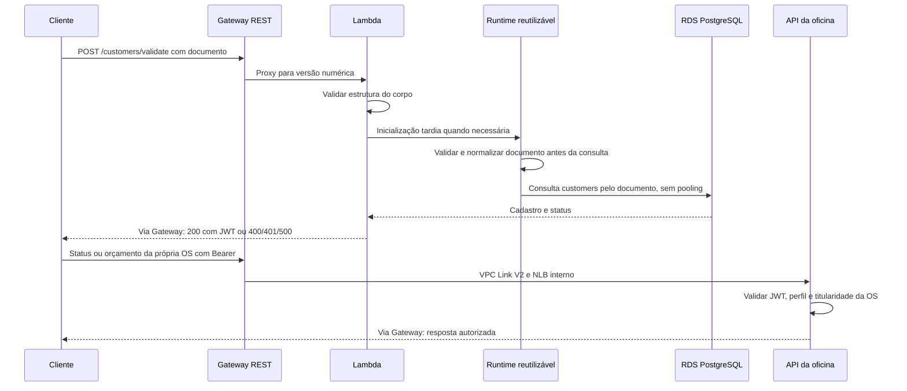

# Funções serverless da oficina

> **Extra em revisão — 22/10/2026:** a implementação local LA.1 de Authorizer/token de orçamento foi substituída como desenho pelo [fluxo planejado de código e SMTP4dev](docs/AUTENTICACAO_E_EMAIL_PLANEJADO.md). O mantenedor descartou o código LA.1, preservando a documentação. As seções abaixo foram alinhadas à base atual por documento; os contratos AE.1 de código/e-mail ainda serão implementados. GitHub, pasta raiz e remote já usam GerenciamentoMecanicaServerless; AuthFunction preserva os nomes de assembly/namespace existentes.

Lambda .NET 10 que valida CPF/CNPJ numérico, consulta elegibilidade pelo documento e emite JWT Customer. O novo fluxo por código substituirá essa emissão por documento isolado. Login com senha de usuários internos permanece na [API](https://github.com/pknfelps/GerenciamentoMecanicaSistema/tree/develop).

## Estado e escopo

Função/SAM/Gateway/JWT/SQL e telemetria foram implantados e conferidos em **hom**. A revisão 01225acd… publicou a Lambda 13 com VersionId S3 fixado e hash do ZIP igual ao código implantado. O ambiente foi destruído ao encerrar a E6 em 21/10/2026; não há endpoint atual. Prd/coexistência, carga e concorrência de publicação não foram comprovados; dispensas e limites não são testes aprovados.

[Revisão E6](https://github.com/pknfelps/GerenciamentoMecanicaSistema/blob/develop/docs/REVISAO_E6_2026-10-21.md), [VersionId/artefatos](https://github.com/pknfelps/GerenciamentoMecanicaSistema/blob/develop/docs/VALIDACAO_PROTECAO_ARTEFATOS_2026-10-21.md), [aceite E5](https://github.com/pknfelps/GerenciamentoMecanicaSistema/blob/develop/docs/ENCERRAMENTO_E5_2026-10-21.md) e [descarte/custos](https://github.com/pknfelps/GerenciamentoMecanicaSistema/blob/develop/docs/ENCERRAMENTO_E6_E_CUSTOS_2026-10-21.md).

## Estrutura e arquitetura

| Projeto | Responsabilidade |
|---|---|
| Domain | Identidade, status e elegibilidade; sem AWS/banco |
| Application | Caso de uso e interfaces de consulta/emissão |
| Infrastructure | Configuração AWS, PostgreSQL, documentos/JWT e métricas de acessos |
| AuthFunction | Handler REST proxy, bootstrap/runtime reutilizável e composição OTel |
| ApplicationTests/ContractTests/InfrastructureTests/AuthFunctionTests | Regras, pacote, configuração/adaptadores/PostgreSQL e contrato do handler |

Projetos net10.0, Npgsql 10.0.2/Dapper e pacote Auth.Contracts [1.0.0]. SAM CLI 1.167.0/CloudFormation entrega ZIP linux-x64/framework-dependent, runtime dotnet10/x86_64, 512 MB e timeout 15 s. Não há Dockerfile da função nem novo executável local; [Compose](compose.observability.yaml) inicia somente Collector para conferência manual.



A sequência acima resume o caminho; a [sequência detalhada](https://github.com/pknfelps/GerenciamentoMecanicaSistema/blob/develop/docs/arquitetura/diagramas/VALIDACAO_CPF.md) distingue parsing antes do runtime e validação do documento no caso de uso após inicialização. A função não cria cliente/usuário/OS, não envia notificações e não administra schema.

## Contrato HTTP/JWT

[contracts/openapi.json](contracts/openapi.json), OpenAPI 3.0 estático, define `POST /customers/validate`. Não exige token prévio; esse caminho será substituído pelas duas rotas AE. Corpo JSON com apenas document, string não vazia; Content-Type application/json com charset UTF-8 opcional. Propriedades extras/duplicadas, JSON/Base64/UTF-8 inválidos e tipos incorretos retornam 400 antes do bootstrap de autenticação.

CPF de 11 dígitos ou máscara e CNPJ numérico de 14 dígitos ou máscara são normalizados estritamente; sem espaços/letras/CNPJ alfanumérico. Validação usa o pacote compartilhado, sem mudar seu algoritmo legado. Corpo válido pode inicializar o runtime mesmo com documento posteriormente rejeitado; documento inválido não consulta SQL.

| HTTP | Resposta |
|---|---|
| 200 | Token como string JSON, sem envelope/refresh token |
| 400 | Corpo ou documento inválido |
| 401 | Cliente inexistente ou Inactive; negativa genérica |
| 500 | Falha técnica/timeout tratado, incluindo configuração/SQL/cancelamento |

Sucesso usa application/json; erros tratados usam application/problem+json, campos fixos e instance=/customers/validate. Todas as respostas têm Cache-Control: no-store e isBase64Encoded=false. Erros do próprio Gateway/runtime podem ter formato diferente. No código atual, documento é a entrada da autenticação e não há credencial por OS ou Authorizer. O fluxo AE removerá esse caminho sem manter bypass do código.

JWT atual HS256 com UUID/nome do cadastro, role Customer e expiração de dez minutos, sem order_id/purpose de orçamento. A API atual mantém tolerância de cinco minutos e titularidade; Active após login e ClockSkew zero são mudanças futuras da AE. O [contrato atual](https://github.com/pknfelps/GerenciamentoMecanicaSistema/blob/develop/docs/arquitetura/ACESSO_E_AUTENTICACAO.md) permanece distinto do [contrato extra consolidado](https://github.com/pknfelps/GerenciamentoMecanicaSistema/blob/develop/docs/CONTRATOS_EXTRA_AUTENTICACAO_E_EMAIL.md). Não há refresh/revogação automática.

## Consumo do Auth.Contracts

Infrastructure/ContractTests usam versão exata [1.0.0], sem checkout da API. NuGet.Config reserva o ID ao feed artifacts/auth-contracts. Na raiz, com AWS CLI autenticada e leitura autorizada do pacote:

```powershell
New-Item -ItemType Directory -Force artifacts/auth-contracts
aws s3api get-object --bucket mecanica-artifacts-121754142617-us-east-1 --expected-bucket-owner 121754142617 --key packages/GerenciamentoMecanica.Auth.Contracts/1.0.0/GerenciamentoMecanica.Auth.Contracts.1.0.0.nupkg artifacts/auth-contracts/GerenciamentoMecanica.Auth.Contracts.1.0.0.nupkg
aws s3api get-object --bucket mecanica-artifacts-121754142617-us-east-1 --expected-bucket-owner 121754142617 --key packages/GerenciamentoMecanica.Auth.Contracts/1.0.0/GerenciamentoMecanica.Auth.Contracts.1.0.0.nupkg.sha256 artifacts/auth-contracts/GerenciamentoMecanica.Auth.Contracts.1.0.0.nupkg.sha256
Get-FileHash artifacts/auth-contracts/GerenciamentoMecanica.Auth.Contracts.1.0.0.nupkg -Algorithm SHA256
Get-Content artifacts/auth-contracts/GerenciamentoMecanica.Auth.Contracts.1.0.0.nupkg.sha256
$env:NUGET_PACKAGES = Join-Path (Get-Location) artifacts/nuget/b9080cea9d303722ac072e89421505d728126cdb52d57549da4328b1e18ab4e9
```

Conferir os dois hashes contra b9080cea9d303722ac072e89421505d728126cdb52d57549da4328b1e18ab4e9 **antes do restore**. CI faz a comparação automaticamente e separa cache pelo hash. Não há scripts consumidores Get-AuthContracts/Test-AuthContracts no fluxo atual. [Produção/versionamento](https://github.com/pknfelps/GerenciamentoMecanicaSistema/blob/develop/docs/arquitetura/PACOTE_AUTH_CONTRACTS.md).

## Build, testes e publish locais

SDK 10.0.402 fixado em [global.json](global.json), sem roll-forward. Docker Linux deve estar ativo para PostgreSQL/Testcontainers; não iniciar automaticamente nem ignorar testes indisponíveis. Os testes usam bootstrap/AWS simulados e PostgreSQL descartável, sem RDS/AWS reais.

```powershell
dotnet restore GerenciamentoMecanicaServerless.slnx
dotnet build GerenciamentoMecanicaServerless.slnx -c Release --no-restore
dotnet test GerenciamentoMecanicaServerless.slnx -c Release --no-build --no-restore
dotnet restore AuthFunction/AuthFunction.csproj -r linux-x64
dotnet publish AuthFunction/AuthFunction.csproj -c Release -r linux-x64 --self-contained false --no-restore -o artifacts/publish/function-linux-x64
sam validate --lint --template-file templates/auth.yaml --region us-east-1
sam build --template-file templates/auth.yaml
```

Publish local não implanta recursos. Conferir DLL/deps/runtimeconfig, Certificates/rds-ca.pem e Observability/observability.json/collector.yaml. Testes do handler são a execução integrada local, sem criar servidor/executável próprio. Testes automatizados de transporte/Collector/telemetria da Lambda foram removidos por decisão; testes funcionais e MeterListener de integrações permanecem.

## Inicialização e persistência

Runtime__Environment=hom|prd e AWS_REGION=us-east-1 são obrigatórios ao inicializar autenticação real. Ausente/vazio/inválido falha, sem appsettings de banco/JWT ou alternativa local. O SDK usa a cadeia padrão de credenciais. Construir o handler/bootstrap não lê a configuração de autenticação; a primeira chamada de corpo válido pede o runtime. Observabilidade pode ser criada antes dessa leitura.

SSM String/WithDecryption=false fornece nove campos: jwt-secret-arn/issuer/audience em base/v2 e endpoint/port/database-name/auth-secret-arn/auth-db-user/ssl-mode em database/v2. AWSCURRENT fornece JWT e credencial mecanica_auth; não usa Secret administrativo/database-api. Os valores ficam em memória e a inicialização bem-sucedida é reutilizada por handler. Falha não é armazenada como sucesso e permite nova tentativa; mudanças de Secret exigem nova inicialização.

Leitura AWS tem prazo de oito segundos e retries Standard existentes. Handler reserva um segundo do RemainingTime para resposta. Conexão/comando têm cinco segundos cada, sujeitos ao prazo total. NpgsqlDataSource é fábrica reutilizável, Pooling=false/TLS VerifyFull/GssEncryptionMode=Disable; cada lookup abre e descarta conexão inclusive em erro/cancelamento. CA pública está em [Infrastructure/Certificates/rds-ca.pem](Infrastructure/Certificates/rds-ca.pem).

SQL fixo parametrizado pelo documento canônico seleciona somente id/name/document/status de customers; não consulta orders; consulta sem resultado/Inactive não é falha de banco. Dados corrompidos/status desconhecido/duplicatas são técnicos. Handler implementa descarte explícito para testes/local; a AWS não garante callback de descarte ao encerrar o ambiente de execução.

## Observabilidade

[Manifesto](AuthFunction/Observability/observability.json) configura regras/allowlists/filas e mensagens. SAM fixa OTel, X-Ray e New Relic sempre ativos; sem toggles de workflow. Uma linha JSON técnica por conclusão, com status/categoria/duração/IDs, mais TraceId/SpanId quando habilitado. Sem documento, token, payload, mensagem original ou stack trace.

Somente W3C traceparent seleciona pai OTLP; runtime/cabeçalho X-Ray não são pais da aplicação. Invocação → PostgreSQL e logs correlacionados; AlwaysOn coleta mesmo com pai não amostrado. Baggage/tracestate descartados. X-Ray/polling segue diagnóstico independente, sem árvore unificada prometida.

Layer Collector 0.22.0 (Collector 0.151.0) recebe OTLP em loopback e usa decouple, sem batch periódico adicional. Flush da aplicação compartilha até 500 ms entre sinais e preserva ao menos 500 ms para resposta. Filas limitadas/freeze/encerramento podem perder dados; sem entrega única/replay. Extensão lê License Key do Secrets Manager pela mesma role da função, sem chave em ZIP/variáveis/pipeline.

Mecanica.Auth mede invocações/duração por resultado; Mecanica.Integrations mede acessos PostgreSQL/SSM/Secrets, separando operação/finalidade/resultado. Uma chamada lógica AWS é contada depois dos retries internos, não por tentativa de transporte. [Procedimento](docs/OBSERVABILIDADE_LOCAL.md), [integrações](docs/METRICAS_INTEGRACOES.md) e [limites aceitos E5](https://github.com/pknfelps/GerenciamentoMecanicaSistema/blob/develop/docs/ENCERRAMENTO_E5_2026-10-21.md).

## Workflows, artefatos e operação AWS

| Workflow | Fluxo |
|---|---|
| [auth-ci](.github/workflows/auth-ci.yml) | PR/manual: pacote, suíte .NET/PostgreSQL, SAM/actionlint |
| [auth-publish](.github/workflows/auth-publish.yml) | Manual: testes/build SAM → publicação ZIP/template/OpenAPI |
| [auth-provision](.github/workflows/auth-provision.yml) | Manual: environment/artifact_commit → validar versão/contrato/rede → sam deploy, job único |
| [auth-destroy](.github/workflows/auth-destroy.yml) | Manual: checar Gateway → sam delete → checar ENIs/egress, job único |

Develop/hom e main/prd, OIDC e fila auth-ambiente. O disparo manual autoriza cada operação completa, sem aprovação intermediária; o workflow precisa existir na main para Run workflow. SAM/CloudFormation faz deploy/rollback nativos, sem comandos CloudFormation diretos.

Auth usa SG da base e role persistente do bootstrap. Stack administra função/versões/alias/logs, egress TCP 5432/443 e seis campos auth/v2. Gateway consome versão numérica, não alias live/$LATEST; cada nova versão precisa de atualização Gateway.

ZIP usa chave nativa sam/auth/ambiente/commit e bucket versionado. Template imutável fixa **Bucket/Key/Version** antes do checksum. Republicação idêntica conserva VersionId original após comparar ZIP/template; divergência ou template antigo sem Version exige commit novo. Provision confere a versão exata e SAM usa Code.S3ObjectVersion. A chave é gravável, mas nova versão corrente não altera a seleção publicada.

No SAM CLI 1.167.0, CodeUri objeto preserva ZIP no sam delete; stack/templates operacionais são removidos. Contratos, artefatos de outras revisões, bucket, IAM e SG da base persistem. Auth-destroy exige Gateway/VPC Link ausentes e, ao final, ausência de ENIs/egress; pendência bloqueia sem exclusão manual/espera automática. Ordem: Gateway → API/auth → banco → base.

[Deploy/descarte completo](docs/DEPLOY.md) · [Contratos SSM](https://github.com/pknfelps/GerenciamentoMecanicaSistema/blob/develop/docs/arquitetura/CONTRATOS_ENTRE_REPOSITORIOS.md) · [GitHub Actions](https://github.com/pknfelps/GerenciamentoMecanicaServerless/actions).

O endpoint de negócio, quando provisionado, vem de /mecanica/ambiente/gateway/v2/endpoint, não de Function URL própria. Swagger/Postman pertencem à API e o contrato estático está neste repositório. Não há recurso AWS ativo a partir de exemplos/documentação; PR/publish/provision futuros ficam com o mantenedor.

## Refinamento extra — autenticação do cliente e envio centralizado

**Decisão vigente de 22/10/2026; implementação pendente.** O cliente solicitará um código em request-code e confirmará challengeId/code/document em verify-code. O código será enviado a SMTP4dev privado e consultado na ferramenta de captura, nunca devolvido no endpoint público ou gerado pelo mecânico. Depois, JWT Customer identifica o cliente e permite acessar suas próprias OSs; sem Authorizer/token por OS. Sem entrega real a caixas pessoais. Mensagens são efêmeras; desafios permanecem no PostgreSQL.

AE.2: solução GerenciamentoMecanicaServerless, AuthFunction/AuthFunctionTests e estrutura EmailFunction/EmailFunctionTests criadas; template auth em templates/auth.yaml. GitHub/raiz/remote renomeados em 22/10/2026; transição OIDC inicial aplicada, proteções/Environments conferidos e auth-ci do novo nome aprovado. Plano final de retirada da confiança antiga aprovado/aplicado, policies conferidas e Terraform posterior sem diferenças; AE.2 concluída. Template/stack/workflows e funcionamento email continuam nas etapas futuras. LA.1 é somente histórico; AE.1 está consolidada.

API/auth invocarão somente a função de envio autorizada pelo IAM; essa função concentra SMTP e não acessa o banco/JWT. A API mantém titularidade/Active e regras da OS. A ordem de publicação/descarte e as permissões novas serão preparadas antes da ativação. A migração estrutural AE.2 não implementou o fluxo de código/e-mail; preservou as proteções GitHub e as permissões funcionais existentes.

[Escopo neste repositório](docs/AUTENTICACAO_E_EMAIL_PLANEJADO.md) · [Plano extra AE.1–AE.10](https://github.com/pknfelps/GerenciamentoMecanicaSistema/blob/develop/docs/PLANO_EXTRA_AUTENTICACAO_E_EMAIL.md) · [Histórico LA.1](docs/LA1_AUTHORIZER_ORCAMENTO_2026-10-22.md). Independente dos checklists oficiais E5/E6/E7.

[Contratos consolidados AE.1](https://github.com/pknfelps/GerenciamentoMecanicaSistema/blob/develop/docs/CONTRATOS_EXTRA_AUTENTICACAO_E_EMAIL.md): formatos, erros, limites dos desafios, envio v1, catálogos, rede e execução local. Somente documentação nesta etapa.

## AE.2 — organização local

A solução GerenciamentoMecanicaServerless.slnx agora reúne AuthFunction/AuthFunctionTests e EmailFunction/EmailFunctionTests. Assembly/namespace/handler da autenticação foram preservados; nomes físicos, contrato atual e recursos AWS não mudaram. EmailFunction é somente estrutura, sem handler/envio/testes funcionais até AE.5. Template auth em templates/auth.yaml e configuração samconfig.auth.toml. Plano de transição OIDC aprovado/aplicado; GitHub, pasta raiz e remote já renomeados, com checkout preservado. Auth-ci do novo nome aprovado; plano final aprovado/aplicado, confiança antiga retirada e Terraform posterior sem diferenças. AE.2 concluída. [Procedimento AE.2](docs/MIGRACAO_AE2_SERVERLESS.md).


AE.3 revisada: tabelas no Init.sql do banco vazio, sem migrations nem regras de negócio no DDL. Na futura request-code, consultar cliente antes de qualquer gravação; inexistente gera somente log técnico sanitizado e resposta genérica, sem persistir limite/desafio ou invocar envio. Limite de cliente elegível usa UUID, sem índice HMAC de documento. [Contrato vigente](https://github.com/pknfelps/GerenciamentoMecanicaSistema/blob/develop/docs/CONTRATOS_EXTRA_AUTENTICACAO_E_EMAIL.md).

## AE.3 — operações transacionais preparadas

[Criação, ativação, invalidação e consumo em C#](docs/AE3_OPERACOES_TRANSACIONAIS.md) implementados como componentes separados do handler atual. Regras de estado/prazo/tentativas no domínio; transações Npgsql com locks por UUID e revalidação do cadastro. Cliente inexistente sem gravação; assinatura antes do commit; tentativas negativas persistidas e uma confirmação retornada nas chamadas concorrentes. Regressão local: 309 testes aprovados, sem falhas/ignorados. Grants/limpeza seguem pendentes; ligação HTTP/Invoke na AE.6. Sem publicação AWS.
