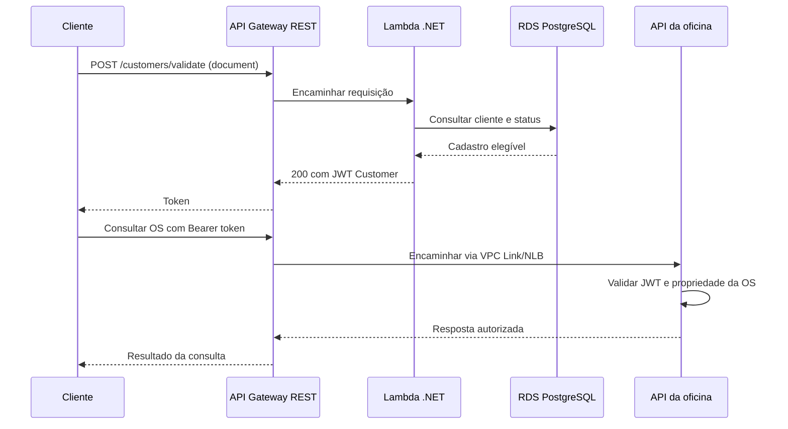

# Autenticação de Clientes do Sistema de Gerenciamento de Mecânica

Repositório da futura função AWS Lambda que valida o documento (CPF ou CNPJ numérico) de um cliente e emite um JWT para acesso às suas ordens de serviço. O login com senha dos usuários internos permanece na API da oficina.

## Estado da implementação

Este repositório contém uma solução .NET 10 organizada em Domain, Application, Infrastructure e Function, com ApplicationTests, ContractTests e InfrastructureTests. A parte 3 implementa o fluxo interno de validação do documento, consulta de elegibilidade e emissão JWT, usando configuração/conexão da parte 2. **Ainda não há handler Lambda ou endpoint executável.** Terraform, IAM e CI/deploy da função permanecem nas próximas entregas.

A tecnologia definida é .NET 10 em AWS Lambda, empacotada como ZIP, com RDS PostgreSQL e JWT compatível com a API. O contrato compartilhado `GerenciamentoMecanica.Auth.Contracts` foi extraído na API como pacote NuGet 1.0.0. A versão 1.0.0 foi publicada no S3 via OIDC em 2026-09-25; o sucesso do workflow de consumo remoto foi confirmado pelo mantenedor. A Infrastructure referencia essa versão exata do pacote e já implementa os adaptadores de normalização e emissão JWT. O uso pelo handler Lambda será integrado posteriormente.

## Estrutura da solução

A [solução](GerenciamentoMecanicaAutenticacao.slnx) reúne os quatro projetos de produção, ApplicationTests para domínio/caso de uso, ContractTests independente e InfrastructureTests para configuração, adaptadores e integração PostgreSQL. As dependências das camadas de produção seguem esta organização:

| Projeto | Responsabilidade | Referências de projetos |
|---|---|---|
| [Domain](Domain/Domain.csproj) | Modelos e regras do domínio da autenticação | Nenhuma |
| [Application](Application/Application.csproj) | Casos de uso e interfaces de consulta/emissão | Domain |
| [Infrastructure](Infrastructure/Infrastructure.csproj) | Configuração AWS, banco e adaptação do pacote compartilhado | Domain e Application |
| [Function](Function/Function.csproj) | Entrada Lambda e composição das dependências | Application e Infrastructure |

Todos são bibliotecas net10.0, com nullable e implicit usings habilitados. Assemblies e namespaces usam o prefixo GerenciamentoMecanica.Autenticacao seguido do nome da camada. Domain e Application não dependem de AWS, banco ou tipos Lambda. Infrastructure é a camada de produção que referencia Auth.Contracts [1.0.0]; ContractTests continua consumindo o pacote diretamente e sem referência aos projetos de produção.

Não há classes ou interfaces de exemplo; cada classe, interface ou enum tem arquivo próprio. Domain define identidade/status e elegibilidade; Application define interfaces e o caso de uso; Infrastructure adapta documentos, PostgreSQL e JWT; Function compõe o caso de uso no contexto descartável. A próxima parte implementará o handler Lambda e seu contrato HTTP.

## Responsabilidades e limites

A função deverá normalizar/validar documento CPF/CNPJ, consultar diretamente o cliente e seu status com credencial de leitura limitada, verificar elegibilidade e emitir JWT de role Customer. Conexões serão encerradas ao fim da operação, sem pooling, conforme a arquitetura aceita.

Não haverá login do cliente com senha, refresh token ou gerenciamento de OS nesta função. Criação de OS continua exclusiva da oficina. A API valida assinatura, role e propriedade das ordens ao receber o token. Segredos não vêm do corpo da requisição.

## Fluxo planejado



O diagrama não representa uma implantação existente. Casos de documento inválido e cliente inelegível seguem o contrato abaixo.

## Contrato HTTP planejado

`POST /customers/validate`, encaminhado pelo API Gateway à Lambda, com `Content-Type: application/json`:

```json
{
  "document": "529.982.247-25"
}
```

| Código | Resultado |
|---|---|
| 200 | Token no corpo, sem envelope de sessão/refresh token |
| 400 | Corpo ou documento inválido |
| 401 | Documento válido sem cliente elegível: inexistente ou Inativo |
| 5xx | Falha técnica inesperada da função ou integração; não converter em 401 |

A fonte completa é o [contrato de acesso e autenticação](https://github.com/pknfelps/GerenciamentoMecanicaSistema/blob/develop/docs/arquitetura/ACESSO_E_AUTENTICACAO.md). A função usará HS256, expiração de dez minutos, issuer/audience/chave compatíveis com a API do mesmo ambiente e claims obtidas do cadastro. Configuração secreta ficará no Secrets Manager.

O Init.sql do repositório de banco já contém o campo customers.status, com valor inicial Active, e a credencial mecanica_auth tem SELECT restrito a id, name, document e status. Esquema e credenciais foram entregues e validados em hom. A consulta já está implementada no fluxo interno; execução pela Lambda e validação real AWS permanecem pendentes.

## Pré-requisitos e execução

Para compilar esta entrega, usar .NET SDK 10 e o pacote GerenciamentoMecanica.Auth.Contracts 1.0.0 no feed local artifacts/auth-contracts. Os comandos abaixo partem da raiz do repositório e pressupõem o pacote já obtido e validado pelo procedimento de consumo. Restore/build/publish e testes unitários não precisam de banco ativo nem de configuração AWS/JWT. Os testes de integração exigem Docker Desktop com engine Linux ativo; Testcontainers obtém postgres:16.15, cria um banco local descartável e o remove ao final. Esses testes usam credenciais fictícias, sem acesso AWS/RDS, e não são ignorados quando Docker está indisponível.

Executar com as ferramentas padrão do .NET:

```powershell
dotnet restore GerenciamentoMecanicaAutenticacao.slnx
dotnet build GerenciamentoMecanicaAutenticacao.slnx -c Release --no-restore
dotnet test GerenciamentoMecanicaAutenticacao.slnx -c Release --no-build --no-restore
dotnet publish Function/Function.csproj -c Release --no-restore -o artifacts/publish/function
```

O publish gera as bibliotecas e suas dependências para inspeção local; não produz uma Lambda invocável nem publica recursos na AWS. Não há dependência de checkout da API. O login interno permanece em POST /authentication na [API da oficina](https://github.com/pknfelps/GerenciamentoMecanicaSistema/tree/develop).

## Inicialização e conexão — parte 2

[FunctionBootstrap](Function/FunctionBootstrap.cs) expõe InitializeAsync com cancelamento. Construir o bootstrap não cria clientes nem acessa AWS; chamar InitializeAsync realiza o carregamento e retorna um FunctionRuntime com configuração JWT e NpgsqlDataSource. Não existe inicializador estático nem handler que dispare esse fluxo automaticamente.

As variáveis obrigatórias são Runtime__Environment=hom|prd e AWS_REGION=us-east-1. Ausência, vazio ou valor diferente interrompe a inicialização antes de criar os clientes AWS. Tanto a futura Lambda quanto uma execução local usarão o mesmo caminho AWS, sem appsettings com chave/senha nem modo local alternativo. O SDK usa a cadeia padrão de credenciais: perfil/sessão compatível localmente e role da futura Lambda, sem chaves no código.

O [carregador](Infrastructure/Configuration/AwsRuntimeConfigurationLoader.cs) recebe clientes AWS pelo construtor. Consulta uma vez os nove parâmetros String públicos com GetParameters e WithDecryption=false:

| Prefixo | Campos |
|---|---|
| /mecanica/<ambiente>/base/v2/ | jwt-secret-arn, jwt-issuer, jwt-audience |
| /mecanica/<ambiente>/database/v2/ | endpoint, port, database-name, auth-secret-arn, auth-db-user, ssl-mode |

Busca somente AWSCURRENT dos Secrets JWT e database/auth. Os ARNs devem corresponder à conta 121754142617, região us-east-1 e ambiente escolhido; nenhum Secret administrativo, database/api ou JWT de outro ambiente é aceito. JWT fornece key com pelo menos 32 caracteres; o Secret do banco fornece username=mecanica_auth e password preenchido. Endpoint, porta e database vêm do SSM, ignorando host/port/dbname antigos do Secret. Parâmetros e campos inválidos impedem a criação do contexto; nenhuma configuração parcial é publicada.

A leitura completa tem prazo de oito segundos, com cancelamento externo e retry Standard de duas novas tentativas por operação. Erros não preservam respostas AWS, JSON, chave, senha, string de conexão ou exceções internas. A configuração tipada usa classes que não imprimem seus campos em ToString. O prazo de oito segundos é o limite da leitura, não uma garantia para toda a fase Init: o limite inicial de dez segundos da Lambda também inclui runtime/extensões. A implantação futura deverá medir esse comportamento.

A conexão usa Npgsql 10.0.2, NpgsqlConnectionStringBuilder, TLS VerifyFull, GssEncryptionMode=Disable, Pooling=false, timeout de conexão e de comando de cinco segundos. O certificado público [rds-ca.pem](Infrastructure/Certificates/rds-ca.pem) é o mesmo usado pelo banco e é copiado para Certificates/rds-ca.pem no build/publish. Sua ausência interrompe o carregamento; manter a CA atualizada quando a configuração do RDS mudar.

Inicializar o contexto ou criar o data source não abre conexão. O futuro handler deverá inicializar uma vez por ambiente de execução e reutilizar o FunctionRuntime, sem novas leituras AWS por operação. O adaptador de consulta já usa Database.OpenConnectionAsync com cancelamento e await using para encerrar a conexão inclusive em erro. FunctionRuntime implementa IDisposable/IAsyncDisposable e descarta seu data source; o bootstrap descarta os clientes AWS no sucesso e em falha. Uma mudança de Secret/configuração exige nova inicialização do contexto, sem recarga automática.

InfrastructureTests valida carregamento hom/prd, erros, cancelamento/prazo, mensagens sem segredos, parâmetros, AWSCURRENT, conexão preparada e descarte. Os testes não consultam AWS nem abrem conexão com RDS. Conseguir ler SSM/Secrets localmente não fornece acesso de rede ao RDS privado; IAM, rede e conexão real TLS serão conferidos após a entrega de infraestrutura/deploy. Não há inicialização de schema, seeds, grants ou usuário no código da aplicação.

## Fluxo interno de autenticação — parte 3

FunctionRuntime.Authentication expõe [ValidateCustomerDocumentUseCase](Application/Authentication/ValidateCustomerDocumentUseCase.cs), com ExecuteAsync(document, cancellationToken). Não há entrada HTTP; o resultado interno distingue InvalidDocument, NotEligible e Authenticated. Somente Authenticated contém token, e o objeto de resultado não o imprime em ToString. O futuro handler mapeará os resultados para 400, 401 e 200 com token como string JSON, respectivamente.

A sequência é cancelamento, validação/normalização do documento, consulta do cadastro, elegibilidade e emissão. Documento inválido não consulta o banco; cadastro ausente ou Inactive não emite token. Falhas SQL, corrupção de dados e cancelamento propagam como falhas técnicas, sem serem convertidos em 400/401. Não são registrados documento, token, senha ou string de conexão.

O [normalizador](Infrastructure/Documents/CustomerDocumentNormalizer.cs) aceita somente CPF ASCII de 11 dígitos ou máscara XXX.XXX.XXX-XX e CNPJ numérico ASCII de 14 dígitos ou máscara XX.XXX.XXX/XXXX-XX. Rejeita espaços, letras, caracteres extras e máscaras incorretas antes de delegar os dígitos verificadores/canonização a DocumentRules. Preserva as sequências repetidas aceitas pelo pacote; não adiciona suporte a CNPJ alfanumérico nem altera o pacote compartilhado.

CustomerIdentity contém ID, nome, documento canônico e CustomerStatus Active/Inactive. Identidade vazia, nome/documento inválido ou status desconhecido não podem originar token. O [adaptador PostgreSQL](Infrastructure/Persistence/PostgreSqlCustomerLookup.cs) usa Dapper 2.1.79 e SQL fixo, selecionando somente id, name, document e status de public.customers pelo parâmetro Document. Não consulta telefone/email, não filtra Inactive no SQL e não escreve dados. QuerySingleOrDefaultAsync rejeita resultados múltiplos; status desconhecido ou cadastro corrompido são falhas técnicas. A conexão e o comando aceitam cancelamento, o comando tem timeout de cinco segundos e a conexão é descartada inclusive em erro.

O [emissor JWT](Infrastructure/Authentication/CustomerTokenIssuer.cs) delega ao JwtIssuer do pacote fixado em [1.0.0]. ID/nome vêm do cadastro, role é sempre Customer e issuer/audience/chave vêm da configuração inicial. A expiração é UTC + dez minutos, com HS256, Name, Role e NameIdentifier. Nenhuma entrada escolhe ID, role, issuer, audience ou expiração; não há refresh token ou sessão persistida. O emissor aceita TimeProvider para testes.

ApplicationTests usa dependências substituídas para testar o caso de uso. InfrastructureTests testa documentos, tokens reais e uma fixture PostgreSQL 16.15 em Docker, com mecanica_auth limitado às quatro colunas. Verifica SQL parametrizado, status/cadastro inválido, duplicatas, cancelamento, timeout, fechamento das conexões e proibição de leitura de telefone/email ou escrita. A fixture cria somente dados/schema de teste em C#, sem copiar Init.sql nem criar scripts. Conexão sem TLS é exclusiva da fixture local; não muda o TLS VerifyFull de produção e não comprova IAM/rede/CA do RDS. ContractTests permanece independente.

## Consumo do Auth.Contracts

[ContractTests](ContractTests/ContractTests.csproj) fixa o pacote em `[1.0.0]`, sem ProjectReference para a API. [Get-AuthContracts.ps1](scripts/Get-AuthContracts.ps1) verifica sidecar SHA-256, identidade e versão do nuspec antes de atualizar o feed local. [NuGet.Config](NuGet.Config) reserva o ID do pacote para esse feed; [Test-AuthContracts.ps1](scripts/Test-AuthContracts.ps1) usa cache separado pelo hash e executa os testes.

```powershell
# AWS CLI autenticada; pacote previamente publicado pela API:
pwsh -File scripts/Test-AuthContracts.ps1 -Bucket mecanica-artifacts-121754142617-us-east-1

# Verificação offline: receber somente nupkg e .sha256, sem fontes da API:
pwsh -File scripts/Test-AuthContracts.ps1 -PackagePath C:/artefatos/GerenciamentoMecanica.Auth.Contracts.1.0.0.nupkg

# Rejeição de arquivo corrompido, hash/referência inválidos e versão divergente:
pwsh -File scripts/tests/Test-AuthContractsDownload.ps1 -PackagePath artifacts/auth-contracts/GerenciamentoMecanica.Auth.Contracts.1.0.0.nupkg
```

Os scripts e workflows atuais de diagnóstico/consumo permanecem preservados nesta entrega. Sua simplificação será realizada na parte específica de workflows; não foram criados scripts novos.

O [workflow auth-contracts-check](.github/workflows/auth-contracts-check.yml) valida download e consumo com a role auth em develop/hom ou main/prd. Requer workflow disponível na branch padrão para acionamento manual. Não provisiona nem publica Lambda. As variáveis usadas são AWS_REGION, AWS_ROLE_ARN e ARTIFACTS_BUCKET já existentes.

O pacote oferece DocumentRules para identificar/validar CPF ou CNPJ numérico e CpfRules/CnpjRules para usos específicos, preservando os cálculos do legado. O campo document aceita os dois formatos, com ou sem máscara. O fluxo interno já valida o formato estrito do documento, consulta clientes/status e emite a partir da identidade do cadastro. Parsing/validação do corpo HTTP ainda serão implementados no handler. Os testes atuais comprovam o consumo binário de documentos CPF/CNPJ e JWT, não a autenticação completa.

Procedimento do produtor e regras de versionamento: [operação do pacote](https://github.com/pknfelps/GerenciamentoMecanicaSistema/blob/develop/docs/arquitetura/PACOTE_AUTH_CONTRACTS.md). Publicação do pacote independe de deploy da API/RDS; os ambientes reutilizam a mesma versão imutável.

## CI e deploy planejados

O workflow deverá compilar, testar e empacotar um ZIP versionado; Terraform/IAM da função pertencerão a este repositório. A entrega AWS usará OIDC e dependerá de rede privada, banco com esquema, credenciais de leitura e segredo JWT. O contrato OpenAPI será publicado junto da versão da função e consumido pela infraestrutura para compor o Gateway.

A observabilidade seguirá OpenTelemetry com extensão Collector local na Lambda e exportação ao New Relic. Versões/compatibilidade e testes de correlação ainda serão verificados. Existem o diagnóstico manual OIDC e a verificação manual do consumo do pacote; CI da função e deploy ainda serão implementados.

## Contratos de integração

A [especificação central](https://github.com/pknfelps/GerenciamentoMecanicaSistema/blob/develop/docs/arquitetura/CONTRATOS_ENTRE_REPOSITORIOS.md) define a interface do produtor **auth**. O [contrato HTTP/JWT](https://github.com/pknfelps/GerenciamentoMecanicaSistema/blob/develop/docs/arquitetura/ACESSO_E_AUTENTICACAO.md) permanece a fonte de payloads, códigos e claims. A função/Terraform/deploy ainda serão implementados.

| Interface | Responsabilidade da autenticação |
|---|---|
| Consome no build | NuGet GerenciamentoMecanica.Auth.Contracts em versão exata e checksum; baixar do S3 para feed local antes do restore |
| Consome da base | VPC/subnets privadas/SG, JWT por ARN, issuer/audience e configuração New Relic quando habilitada |
| Consome do banco | Endpoint/porta/database/TLS, schema-version/hash e auth-secret-arn |
| Resolve no runtime | Credencial de leitura de clientes, chave JWT e ingestão New Relic; não usa a credencial de escrita da API |
| Publica artefatos | lambda/<commit>/function.zip e contracts/auth/<commit>/openapi.json, cada um com .sha256 |
| Publica em SSM | /mecanica/<ambiente>/auth/v2/: configuração Terraform de função/versão/ARN qualificado, ZIP, OpenAPI e versão do pacote; sem releases/tentativas |
| Solicita após deploy | Plano e aprovação manual do Gateway com contratos fixos da API e da função |

O build não depende de checkout local da API nem de RDS ativo; depende da versão do pacote já publicada. A publicação do pacote pela API também não depende desta função, evitando ciclo de bootstrap.

A validação operacional exige atualização Lambda concluída, versão numérica publicada, conectividade e testes de contrato aprovados. Gateway consome o ARN qualificado dessa versão, não $LATEST, e é dono da permissão de invocação. Não é necessário ter Gateway disponível para publicar a configuração v2 da função.

O [diagnóstico manual OIDC](.github/workflows/aws-oidc-check.yml) testa a role auth do Environment em develop/hom ou main/prd. Entradas: AWS_REGION, AWS_ROLE_ARN, TF_STATE_BUCKET e ARTIFACTS_BUCKET. Ele comprova autenticação, não substitui CI de .NET, testes funcionais ou validação das permissões de deploy/secrets.

## Desenvolvimento e ambientes

Todo trabalho parte da `develop` atualizada, com branch de tarefa e PR para `develop`. A promoção `develop -> main` ocorrerá ao concluir a entrega. **hom** e **prd** terão funções e configurações próprias, compatíveis com API e banco do mesmo ambiente; essa separação ainda será provisionada.

## Referências

- [Arquitetura de execução](https://github.com/pknfelps/GerenciamentoMecanicaSistema/blob/develop/docs/arquitetura/rfcs/001-EXECUCAO.md).
- [Entrega e contratos entre componentes](https://github.com/pknfelps/GerenciamentoMecanicaSistema/blob/develop/docs/arquitetura/rfcs/002-ENTREGA.md).
- [Dados e observabilidade](https://github.com/pknfelps/GerenciamentoMecanicaSistema/blob/develop/docs/arquitetura/rfcs/003-DADOS-E-OBSERVABILIDADE.md).
- [Infraestrutura](https://github.com/pknfelps/GerenciamentoMecanicaInfraestrutura/tree/develop).
- [Banco](https://github.com/pknfelps/GerenciamentoMecanicaBancoDados/tree/develop).

A reformulação declarativa mantém os testes de negócio e o consumo imutável de Auth.Contracts. O futuro Terraform da função consumirá `/mecanica/<ambiente>/base/v2/` e `/mecanica/<ambiente>/database/v2/`, resolvendo `auth-secret-arn` sem usuário administrativo. SSM é configuração, sem atestar prontidão. [ADR 008](https://github.com/pknfelps/GerenciamentoMecanicaSistema/blob/develop/docs/arquitetura/adrs/008-INFRAESTRUTURA-DECLARATIVA.md).

## Preparação JWT — E2.12

Infraestrutura JWT da base e consumo pela API entregues e validados em hom em 2026-10-08. O ciclo completo de descarte foi confirmado pelo mantenedor em 2026-10-09; recriar base/banco antes da futura validação AWS da função. Carregamento JWT da autenticação implementado e testado localmente; emissão JWT do fluxo interno também testada localmente; integração ao handler Lambda e comprovação real em hom/prd permanecem pendentes. Consumir /mecanica/<ambiente>/base/v2/jwt-secret-arn, jwt-issuer e jwt-audience. Secret /mecanica/<ambiente>/base/jwt é JSON com somente key; issuer mecanica-<ambiente>-auth e audience mecanica-<ambiente>-api, distintos entre hom/prd.

Na implementação posterior da Lambda, sua role terá leitura somente do JWT e da credencial auth do ambiente. O bootstrap já carrega configurações e AWSCURRENT pelo SDK .NET, mantém os valores em memória e impede a inicialização diante de leitura/configuração inválida, sem fallback local. A emissão interna usa JwtIssuer do pacote 1.0.0, com HS256, expiração de dez minutos, ID/nome do cadastro e role Customer. As opções de validação/tolerância de relógio da API permanecem iguais. Function continua sendo biblioteca sem entrada invocável; handler, role de execução e deploy Lambda serão implementados posteriormente. [Operação JWT](https://github.com/pknfelps/GerenciamentoMecanicaInfraestrutura/blob/develop/docs/JWT_COMPARTILHADO.md).
